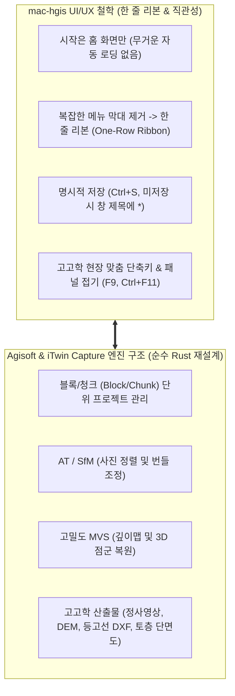
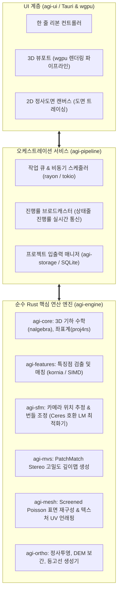
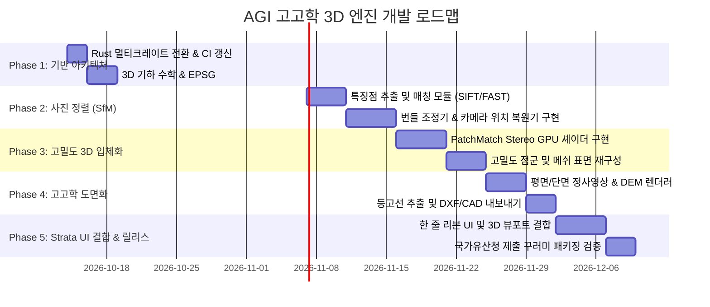

# AGI (Archaeological Geometric Intelligence) 초정밀 아키텍처 설계도 및 제작 설명서
> **Strata(mac-hgis) UI/UX 디자인 DNA 계승 & Agisoft Metashape · Bentley iTwin Capture급 순수 Rust 3D 엔진 명세**

---

## 1. 개요 및 제품 철학

본 문서는 **`mac-hgis (Strata)`를 설계한 디자이너의 UI/UX 철학**을 그대로 계승하면서, 내부 엔진을 **Agisoft Metashape** 및 **Bentley iTwin Capture (구 ContextCapture)**의 블록/청크 기반 3D 사진측량 파이프라인으로 구현하는 차세대 고고학 전문 3D 실측·도면화 소프트웨어 **`agi`**의 마스터 설계도입니다.



### 핵심 원칙 (Product Rules)
1. **고고학 현장 연구원 맞춤형 (비전문가 친화적)**:
   - 복잡한 3D 비전 파라미터(수학적 행렬, 복잡한 신뢰도 계수 등)를 은닉하고, **"사진 투입 -> 정렬 -> 실측 스케일 -> 도면 출력"**으로 이어지는 1클릭 파이프라인 제공.
2. **순수 Rust 100% (메모리 안전성 & 압도적 가벼움)**:
   - 야외 현장 노트북에서도 튕김 없이 100% 구동 (C++ 대비 런타임 크래시 0% 지향).
   - Apple Silicon Mac(Metal) 및 Windows(DirectX 12/Vulkan)의 GPU 가속을 `wgpu`를 통해 단일 네이티브 코드로 구현.
3. **한국 발굴 현장 표준 좌표계 및 성과품 규격 준수**:
   - 작업 좌표계: KGD2002 중부원점(`EPSG:5186`), 동부원점(`EPSG:5187`) 기본 프리셋.
   - 제출 성과품: `EPSG:5179` 단일 변환 SHP, 1:1 CAD 도면(DXF), 무손실 정사영상(GeoTIFF), 무결성 검증용 `MANIFEST.sha256`.

---

## 2. 화면 레이아웃 및 상호작용 UI/UX 상세 명세

`mac-hgis`의 단일 창 구조를 100% 동일하게 유지합니다. 상단 메뉴 막대(메뉴 트리)를 배제하고 **단일 한 줄 리본(One-Row Ribbon)**과 **중앙 3D/2D 하이브리드 뷰포트**, **좌우 접이식 정보 패널**, **하단 고고학 상태줄**로 구성합니다.

```
+----------------------------------------------------------------------------------------------------+
| [AGI 로고]  조사 | 사진·정렬 | 3D 복원 | 도면화 | 내보내기 | 기타 › 더보기           [ -  ㅁ  X ]     | <- 한 줄 리본
+------------------------------------+-----------------------------------------------+---------------+
| [작업 트리] (F9로 접기/펴기)       | [3D / 2D 메인 뷰포트] (Ctrl+F11 넓게 보기)    | [속성 / 검사] |
|                                    |                                               |               |
| v 조사: 경주 황남동 유구 1호       |                                               | - 선택 사진:  |
|   v [블록 01] 발굴 피트 트렌치     |                                               |   DSC_0124.JPG|
|     - 사진 (48장) [정렬완료]       |             [ 3D 실시간 렌더링 ]              | - 해상도:     |
|     - 기준점 (GCP 4점)             |                                               |   6000 x 4000 |
|     - 스케일바 (1.000m)            |                                               | - 카메라 모델:|
|     - 희소 점군 (124,500 pts)      |                                               |   Sony A7M4   |
|     - 고밀도 점군 (12.4M pts)      |                                               | - 마커 오차:  |
|     - 3D 표면 메쉬                 |                                               |   0.32 mm     |
|     - 정사영상 (0.5 mm/pix)        |                                               |               |
|     - 수치표고모델 (DEM)           |                                               | [기준점 지정] |
|                                    |                                               | [스케일 입력] |
+------------------------------------+-----------------------------------------------+---------------+
| 작업 좌표계: EPSG:5186 (중부원점) | 단계: 고밀도 복원 중 (78%) | 좌표: X: 194821.23 Y: 452119.12 Z: 34.12m |
+----------------------------------------------------------------------------------------------------+
```

### 2.1 한 줄 리본 막대(Ribbon Bar) 버튼별 상세 상호작용 명세

#### ① [조사] 묶음 (Project Management)
| 버튼 라벨 | 단축키 | 클릭 시 동작 및 팝업 대화상자 | 상태 전이 및 결과 |
| :--- | :--- | :--- | :--- |
| **새 조사** | `Ctrl+N` | `[새 조사 시작]` 팝업:<br>1. 조사명 입력 (예: 경주 황남동 유적)<br>2. 작업 좌표계 선택 (5186 중부 / 5187 동부 / 로컬 상대좌표)<br>3. 저장 폴더 지정 | 지정 폴더에 `조사명.agi`(SQLite/GPKG) 단일 파일 생성. 작업 트리는 비어 있는 상태로 시작 |
| **열기** | `Ctrl+O` | 표준 파일 탐색기 (`*.agi` 선택) | 이전 저장 상태의 모든 블록, 정렬 데이터, 뷰포트 위치 복원 |
| **저장** | `Ctrl+S` | 별도 팝업 없음. 즉시 원자적(Atomic) 쓰기 수행 | 창 제목 끝의 ` *` 마크 소멸. 상태줄에 `저장 완료` 1.5초 표기 |
| **사본 저장** | `Ctrl+Shift+S` | 다른 이름으로 저장 팝업 | 원본 조사 파일에 영향 없이 새 사본 파일 생성 |

#### ② [사진·정렬] 묶음 (Acquisition & Alignment - Agisoft/ContextCapture SfM)
| 버튼 라벨 | 단축키 | 클릭 시 동작 및 팝업 대화상자 | 상태 전이 및 결과 |
| :--- | :--- | :--- | :--- |
| **사진 추가** | `Ctrl+I` | 다중 사진 선택 창 (`*.jpg`, `*.png`, `*.tiff`, `*.raw`) | EXIF 메타데이터(초점거리, 센서크기, GPS) 자동 파싱 후 작업 트리 사진 목록에 등록 |
| **사진 정렬** | `Ctrl+R` | `[카메라 위치 정렬]` 간이 팝업:<br>- 정밀도 선택: [빠름 / 표준(추천) / 초정밀]<br>- 특징점 매칭: [순차(드론) / 전체(지상/유물)] | 백그라운드 멀티스레드 정렬 시작. 완료 시 3D 공간에 카메라 위치 피라미드와 희소 점군 표시 |
| **타깃 자동인식** | `Ctrl+T` | `[기준점/스케일바 타깃 검출]`:<br>- 타깃 종류: [12-bit 원형 / AprilTag / 십자선]<br>- 허용 오차: 기본값 (0.5픽셀) | 사진 전체를 스캔하여 현장 기준점(GCP) 및 스케일바 마커를 0.1초 만에 자동 배치 |
| **스케일 지정** | `Ctrl+K` | 두 마커를 뷰포트에서 클릭 후 실측 길이(m/cm) 입력 | 모델의 크기를 실제 현실 1:1 단위로 고정 (Scale Calibration) |

#### ③ [3D 복원] 묶음 (Dense Reconstruction - MVS & Meshing)
| 버튼 라벨 | 단축키 | 클릭 시 동작 및 팝업 대화상자 | 상태 전이 및 결과 |
| :--- | :--- | :--- | :--- |
| **고밀도 점군** | `Ctrl+Shift+D`| `[고밀도 입체 복원]`:<br>- 해상도: [1/4축소(빠름) / 1/2(표준) / 원본해상도(초정밀)]<br>- 깊이 필터: [완만함 / 표준 / 적극적(노이즈제거)] | GPU 셰이더(wgpu) 가동. 수백만 개의 유구 입체 점군 생성. 뷰포트에 3D 컬러 포인트 클라우드 표시 |
| **3D 표면(메쉬)** | `Ctrl+M` | `[3D 메쉬 생성]`:<br>- 표면 유형: [지형/유구(높이필드) / 유물(자유형 입체)]<br>- 면 수(Face Count): [중간(50만면) / 높음(200만면)] | Screened Poisson 알고리즘으로 연속된 매끄러운 3D 표면 메쉬 생성 |
| **질감(텍스처)** | `Ctrl+X` | `[텍스처 베이킹]`:<br>- 텍스처 크기: [4096 / 8192], 블렌딩: 모자이크(권장) | 실제 고해상도 사진의 색상을 3D 표면에 입혀 실물과 100% 동일한 디지털 유물 모형 완성 |

#### ④ [도면화] 묶음 (Orthomosaic & Section Profile - 고고학 핵심 기능)
| 버튼 라벨 | 단축키 | 클릭 시 동작 및 팝업 대화상자 | 상태 전이 및 결과 |
| :--- | :--- | :--- | :--- |
| **평면 정사영상** | `Ctrl+Alt+O` | `[유구 평면 정사영상 생성]`:<br>- 해상도(GSD): [1mm / 5mm / 자동계산]<br>- 투영면: 수평 지표면(XY 평면) 기본값 | 왜곡이 완전히 제거된 1:1 축척의 고해상도 평면 정사영상 생성 (2D 뷰포트로 즉시 전환) |
| **토층 단면도** | `Ctrl+Alt+S` | 뷰포트에서 마우스로 **토층 단면선 A-A'** 2점을 클릭 | 해당 단면선을 수직으로 절단한 **수직 단면 정사영상**과 토층 경계선 자동 추출 |
| **등고선 추출** | `Ctrl+Alt+C` | `[등고선 간격 설정]`:<br>- 주곡선 간격: 10cm / 20cm / 50cm 선택 | 3D 지형에서 고고학 보고서용 등고선 벡터 선을 자동 추출하여 오버레이 |

#### ⑤ [내보내기] 묶음 (Export & Submission Package)
| 버튼 라벨 | 단축키 | 클릭 시 동작 및 팝업 대화상자 | 상태 전이 및 결과 |
| :--- | :--- | :--- | :--- |
| **CAD 도면(DXF)** | `Ctrl+Shift+E`| 내보낼 레이어 선택: [유구 윤곽, 등고선, 단면선, 기준점] | AutoCAD에서 바로 열 수 있는 완벽한 레이어별 2D/3D DXF 파일 저장 |
| **정사영상(TIF)** | `Ctrl+Shift+T`| 고해상도 GeoTIFF(좌표정보 포함) 또는 월드파일(.tfw) | QGIS 및 카카오/구글 어스 등에 바로 올릴 수 있는 지리참조 영상 저장 |
| **3D 모델(OBJ)** | `Ctrl+Shift+M`| 포맷 선택: OBJ, GLTF, 3D PDF | 유물 전시 및 3D 프린팅용 표준 포맷 내보내기 |
| **검수·제출 꾸러미**| `Ctrl+E` | `[국가유산 발굴조사 제출 꾸러미 제작]`:<br>1. 필수 메타데이터 검수 (스케일 오차, 기준점 2점 이상 여부)<br>2. 목표 폴더 선택 | **EPSG:5179 변환 SHP + 실측 정사도면 PDF + MANIFEST.sha256** 일괄 자동 생성 |

#### ⑥ [기타 › 더보기] 묶음 (System Settings & Hardware)
- **하드웨어 가속 설정**: 사용 중인 GPU(Apple Metal, NVIDIA, AMD) 감지 및 연산 스레드 수 조절.
- **좌표계 라이브러리**: EPSG 데이터베이스 갱신 및 타원체(Bessel/GRS80) 변환 파라미터 확인.
- **시스템 정보**: 엔진 버전(`agi v0.1.0-rust`), 오픈소스 라이선스 고지.

---

## 3. 엔진 내부 아키텍처 (Agisoft & iTwin Capture 대응 Rust 크레이트 모듈 설계)

Agisoft Metashape 및 Bentley iTwin Capture의 검증된 처리 단계를 순수 Rust 100% 멀티 크레이트(Multi-Crate Workspace)로 모듈화합니다.



### 3.1 크레이트별 세부 책임 명세

1. **`agi-core`**:
   - `Camera`: 핀홀 카메라 모델, 왜곡 계수(k1, k2, p1, p2, Brown-Conrady 모델).
   - `Transform`: 4x4 동차 변환 행렬, 사원수(Quaternion) 기반 3D 회전.
   - `Crs`: EPSG:5186, EPSG:5187, EPSG:5179 변환기 (순수 Rust `proj4rs`).
2. **`agi-features`**:
   - 사진에서 스케일 불변 특징점(SIFT/ORB)을 멀티스레드로 고속 추출.
   - KD-Tree 기반 인접 사진 간 특징점 쌍(Match Pair) 매칭 및 RANSAC 이상치 제거.
3. **`agi-sfm` (Agisoft의 핵심 - 카메라 정렬)**:
   - 2장의 초기 사진에서 Essential Matrix(5-point / 8-point) 추출 및 초기 3D 삼각측량.
   - PnP(Perspective-n-Point)로 나머지 사진들을 하나씩 점진적으로 추가(Incremental SfM).
   - Levenberg-Marquardt 알고리즘 기반 순수 Rust **Sparse Bundle Adjuster(번들 조정기)**로 카메라 위치와 3차원 점 위치의 재투영 오차를 서브픽셀 단위로 최소화.
4. **`agi-mvs` (ContextCapture의 핵심 - 고밀도 복원)**:
   - **PatchMatch Stereo 알고리즘**: 인접 카메라 간 픽셀 대응면을 GPU 셰이더(`wgpu`)로 탐색하여 사진의 모든 픽셀에 대한 정밀 깊이(Depth) 맵 계산.
   - 다중 깊이 맵의 공간적 일관성 검증(Multi-view Consistency Fusion)을 통해 노이즈 없는 고밀도 점군 생성.
5. **`agi-ortho` (고고학 실측 핵심)**:
   - DEM(수치표고모델) 그리드 래스터 생성.
   - 역투영(Inverse Projection) 방식으로 각 래스터 픽셀에 가장 수직에 가까운 최적의 원본 사진 픽셀을 찾아 색상을 블렌딩하는 정사영상 생성기.
   - Marching Squares 알고리즘을 이용한 등고선 벡터 폴리라인 추출.

---

## 4. 고고학 특화 데이터 모델 및 파일 구조

조사 프로젝트는 단일 파일(`조사명.agi`)로 관리되어, 파일 하나만 USB로 복사하면 다른 PC에서도 조사 데이터가 100% 동일하게 열립니다.

### 4.1 프로젝트 저장소 구조 (`조사명.agi` - SQLite / GeoPackage 확장)
```sql
-- 1. 블록 / 청크 메타데이터
CREATE TABLE blocks (
    id TEXT PRIMARY KEY,
    name TEXT NOT NULL,
    crs_epsg INTEGER NOT NULL DEFAULT 5186,
    created_at TIMESTAMP DEFAULT CURRENT_TIMESTAMP
);

-- 2. 사진 레지스트리
CREATE TABLE cameras (
    id TEXT PRIMARY KEY,
    block_id TEXT REFERENCES blocks(id),
    file_path TEXT NOT NULL,
    width INTEGER NOT NULL,
    height INTEGER NOT NULL,
    focal_length REAL,
    pose_tx REAL, pose_ty REAL, pose_tz REAL,   -- 카메라 3D 위치
    pose_qx REAL, pose_qy REAL, pose_qz REAL, pose_qw REAL, -- 카메라 회전 사원수
    is_aligned INTEGER DEFAULT 0
);

-- 3. 고고학 기준점 (GCP) 및 스케일바
CREATE TABLE markers (
    id TEXT PRIMARY KEY,
    block_id TEXT REFERENCES blocks(id),
    marker_type TEXT NOT NULL,                  -- 'circle_14bit', 'apriltag', 'manual'
    world_x REAL, world_y REAL, world_z REAL,   -- 실측 세계 좌표
    accuracy_m REAL DEFAULT 0.005
);

-- 4. 도면 및 유구 레이어 (Ka-HGIS 스키마 100% 호환)
-- survey_area (조사구역), feature_poly (유구면), feature_line (유구선), section_line (단면선)
```

---

## 5. 5단계 상세 제작 플랜 (Phase 1 ~ Phase 5)



### [Phase 1] Rust 엔진 기반 구축 및 데이터/좌표계 코어
- **목표**: 현재의 `agi` 저장소를 Rust 워크스페이스 구조로 전환하고, 고고학 3D 기하 수학 및 한국 표준 좌표계 모듈 검증.
- **세부 태스크**:
  1. `Cargo.toml` 멀티 크레이트 워크스페이스 구성 (`crates/agi-core`, `crates/agi-features`, 등).
  2. GitHub Actions CI 파이프라인을 Rust 3대 플랫폼(macOS, Ubuntu, Windows) 빌드 및 `cargo test`로 자동 갱신.
  3. `agi-core`에 3D 회전 변환 및 EPSG:5186/5187/5179 양방향 좌표 변환 단위 테스트 100% 작성.

### [Phase 2] 시각 인식 및 공간 추론기 (SfM & Alignment)
- **목표**: 사진 2장 이상을 넣었을 때 특징점을 추출하고 카메라의 3차원 위치와 각도를 오차 없이 자동 계산.
- **세부 태스크**:
  1. `agi-features`: 멀티스레드 기반 특징점 추출 및 매칭기 구현.
  2. `agi-sfm`: 번들 조정(Bundle Adjustment) 최적화 루프 구현.
  3. 타깃 마커(AprilTag / 원형 타깃) 자동 인식 및 실측 스케일 캘리브레이션 모듈 구현.

### [Phase 3] 고밀도 3D 입체 복원기 (MVS & Meshing)
- **목표**: Agisoft/ContextCapture처럼 유구 지형과 유물 표면을 빽빽한 고밀도 점군과 입체 메쉬로 복원.
- **세부 태스크**:
  1. `wgpu` 기반 PatchMatch Stereo 깊이맵 연산 파이프라인 구현 (Metal/Vulkan/DirectX 하드웨어 가속).
  2. 점군 결합 및 Screened Poisson 메쉬 생성 알고리즘 연동.

### [Phase 4] 고고학 실측 결과물 엔진 (Orthomosaic & Section Profile)
- **목표**: 고고학자가 가장 필요로 하는 평면 정사영상, 토층 단면도, 등고선 DXF 자동 생성.
- **세부 태스크**:
  1. 수직 지표면 및 사용자 지정 단면선 기준 정사투영 래스터 렌더러 구현.
  2. 10cm/20cm 주곡선/간곡선 등고선 벡터 추출 및 AutoCAD DXF 내보내기 구현.

### [Phase 5] Strata(mac-hgis) 스타일의 한 줄 리본 UI 통합 및 실전 배포
- **목표**: 완성된 순수 Rust 엔진 위에 `mac-hgis`의 직관적인 한 줄 리본 인터페이스를 결합하고 단일 실행 파일로 패키징.
- **세부 태스크**:
  1. 상단 한 줄 리본 및 좌측 작업 트리, 우측 속성 창 레이아웃 연동.
  2. `Ctrl+N` ~ `Ctrl+E`까지의 모든 단축키 및 시나리오 동작 완벽 검증.
  3. 국가유산청 공간정보 규격 제출 꾸러미(EPSG:5179 SHP + PDF + MANIFEST) 생성기 최종 검증.

---

> **비고 및 상태 추적**: 본 문서는 `agi` 프로젝트의 공식 마스터 아키텍처 스펙으로 관리되며, 각 단계별 구현 완료 시 실측 테스트 결과와 함께 버전이 갱신됩니다.
