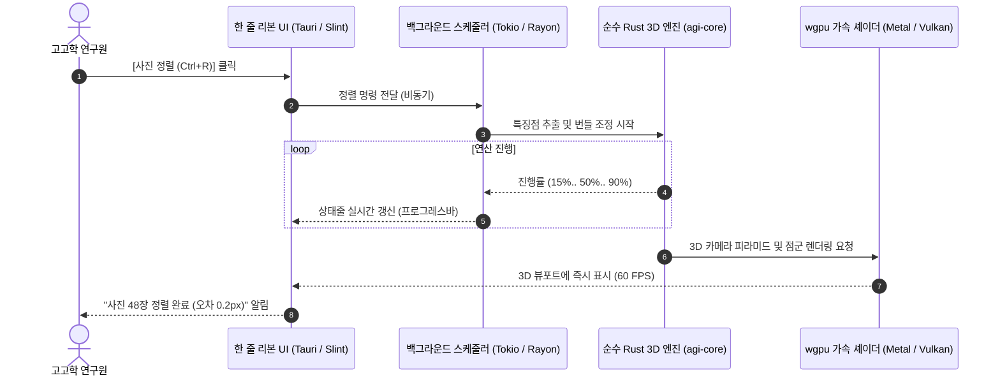

# AGI 고고학 3D 사진측량 소프트웨어 UI/UX 시각 디자인 설계도
> **`mac-hgis (Strata)`의 한 줄 리본 디자인과 Agisoft & ContextCapture 엔진의 완벽한 결합**

본 아티팩트는 실제 개발될 **`agi` 프로그램의 화면 UI/UX 시각 디자인 목업(Visual Mockup)**과 **상호작용 인터랙션 명세**를 담은 최종 상세 설계도입니다.

---

## 1. 화면 시각 디자인 목업 (UI Visual Progression)

아래 캐러셀을 넘기면서 실제 프로그램 구동 화면, 대화상자, 도면화 뷰를 시각적으로 확인하실 수 있습니다.

````carousel
### [슬라이드 1] 메인 작업 화면 (Main Workspace)
> **한 줄 리본 + 좌측 작업 트리(F9) + 중앙 3D 뷰포트(Ctrl+F11) + 우측 속성 패널 + 하단 상태줄**

```html
<div style="font-family: -apple-system, BlinkMacSystemFont, 'Malgun Gothic', sans-serif; background: #1e222b; color: #e1e4ea; border-radius: 8px; border: 1px solid #333a47; overflow: hidden; box-shadow: 0 10px 30px rgba(0,0,0,0.5);">
  <!-- 윈도우 타이틀바 -->
  <div style="background: #14171d; padding: 6px 12px; display: flex; justify-content: space-between; align-items: center; border-bottom: 1px solid #282e3a; font-size: 12px;">
    <div style="display: flex; align-items: center; gap: 8px;">
      <span style="background: #2563eb; color: #fff; font-weight: 900; padding: 2px 6px; border-radius: 4px; font-size: 11px;">AGI</span>
      <span style="font-weight: 600; color: #f1f5f9;">경주 황남동 120-1호분 발굴조사.agi *</span>
      <span style="color: #64748b; font-size: 11px;">(순수 Rust 3D 엔진 v0.1.0)</span>
    </div>
    <div style="display: flex; gap: 14px; color: #94a3b8; font-size: 11px;">
      <span>ㅡ</span>
      <span>ㅁ</span>
      <span style="color: #ef4444;">✕</span>
    </div>
  </div>

  <!-- mac-hgis 스타일의 단일 한 줄 리본 (One-Row Ribbon Bar) -->
  <div style="background: #232834; padding: 6px 10px; display: flex; align-items: center; gap: 4px; border-bottom: 2px solid #2563eb; font-size: 12px; overflow-x: auto;">
    <!-- 조사 그룹 -->
    <div style="display: flex; gap: 2px; padding-right: 6px; border-right: 1px solid #3b4252;">
      <button style="background: #2d3446; color: #fff; border: 1px solid #3e485e; border-radius: 4px; padding: 4px 8px; cursor: pointer; font-weight: 500;">새 조사 <span style="color:#94a3b8; font-size:10px;">^N</span></button>
      <button style="background: #2d3446; color: #fff; border: 1px solid #3e485e; border-radius: 4px; padding: 4px 8px; cursor: pointer;">열기 <span style="color:#94a3b8; font-size:10px;">^O</span></button>
      <button style="background: #2563eb; color: #fff; border: 1px solid #3b82f6; border-radius: 4px; padding: 4px 8px; cursor: pointer; font-weight: 600;">저장 <span style="color:#bfdbfe; font-size:10px;">^S</span></button>
    </div>

    <!-- 사진·정렬 그룹 -->
    <div style="display: flex; gap: 2px; padding: 0 6px; border-right: 1px solid #3b4252;">
      <button style="background: #2d3446; color: #fff; border: 1px solid #3e485e; border-radius: 4px; padding: 4px 8px; cursor: pointer;">사진추가 <span style="color:#94a3b8; font-size:10px;">^I</span></button>
      <button style="background: #10b981; color: #fff; border: 1px solid #059669; border-radius: 4px; padding: 4px 8px; cursor: pointer; font-weight: 600;">사진정렬 <span style="color:#a7f3d0; font-size:10px;">^R</span></button>
      <button style="background: #2d3446; color: #fff; border: 1px solid #3e485e; border-radius: 4px; padding: 4px 8px; cursor: pointer;">타깃인식 <span style="color:#94a3b8; font-size:10px;">^T</span></button>
      <button style="background: #2d3446; color: #fff; border: 1px solid #3e485e; border-radius: 4px; padding: 4px 8px; cursor: pointer;">스케일 <span style="color:#94a3b8; font-size:10px;">^K</span></button>
    </div>

    <!-- 3D 복원 그룹 -->
    <div style="display: flex; gap: 2px; padding: 0 6px; border-right: 1px solid #3b4252;">
      <button style="background: #2d3446; color: #fff; border: 1px solid #3e485e; border-radius: 4px; padding: 4px 8px; cursor: pointer;">고밀도점군</button>
      <button style="background: #2d3446; color: #fff; border: 1px solid #3e485e; border-radius: 4px; padding: 4px 8px; cursor: pointer;">3D 메쉬</button>
      <button style="background: #2d3446; color: #fff; border: 1px solid #3e485e; border-radius: 4px; padding: 4px 8px; cursor: pointer;">텍스처</button>
    </div>

    <!-- 도면화 그룹 (고고학 특화) -->
    <div style="display: flex; gap: 2px; padding: 0 6px; border-right: 1px solid #3b4252;">
      <button style="background: #8b5cf6; color: #fff; border: 1px solid #7c3aed; border-radius: 4px; padding: 4px 8px; cursor: pointer; font-weight: 600;">평면 정사영상</button>
      <button style="background: #8b5cf6; color: #fff; border: 1px solid #7c3aed; border-radius: 4px; padding: 4px 8px; cursor: pointer; font-weight: 600;">토층 단면도</button>
      <button style="background: #2d3446; color: #fff; border: 1px solid #3e485e; border-radius: 4px; padding: 4px 8px; cursor: pointer;">등고선</button>
    </div>

    <!-- 내보내기 그룹 -->
    <div style="display: flex; gap: 2px; padding: 0 6px; border-right: 1px solid #3b4252;">
      <button style="background: #2d3446; color: #fff; border: 1px solid #3e485e; border-radius: 4px; padding: 4px 8px; cursor: pointer;">CAD(DXF)</button>
      <button style="background: #2d3446; color: #fff; border: 1px solid #3e485e; border-radius: 4px; padding: 4px 8px; cursor: pointer;">GeoTIFF</button>
      <button style="background: #f59e0b; color: #000; border: 1px solid #d97706; border-radius: 4px; padding: 4px 8px; cursor: pointer; font-weight: 700;">검수·제출 <span style="font-size:10px;">^E</span></button>
    </div>

    <!-- 기타 -->
    <div style="margin-left: auto;">
      <button style="background: transparent; color: #94a3b8; border: none; cursor: pointer;">더보기 ▾</button>
    </div>
  </div>

  <!-- 메인 바디 영역: 3열 구조 -->
  <div style="display: flex; height: 380px;">
    <!-- 좌측 작업 트리 패널 (F9) -->
    <div style="width: 220px; background: #181b22; border-right: 1px solid #282e3a; padding: 10px; font-size: 11px; overflow-y: auto;">
      <div style="color: #64748b; font-weight: 700; margin-bottom: 6px; text-transform: uppercase;">작업 트리 (F9)</div>
      <div style="color: #38bdf8; font-weight: 600; margin-bottom: 4px;">▼ [블록 01] 트렌치 A구역</div>
      <div style="padding-left: 12px; line-height: 1.8; color: #cbd5e1;">
        <div>📷 사진: 48 / 48장 정렬됨</div>
        <div>🎯 기준점(GCP): 4점 등록</div>
        <div>📏 스케일바: 1.000m (오차 0.2mm)</div>
        <div style="color: #a3e635;">✦ 희소 점군: 142,390 pts</div>
        <div style="color: #38bdf8;">✦ 고밀도 점군: 8.4M pts</div>
        <div>▲ 3D 표면 메쉬: 120만면</div>
        <div>🗺️ 평면 정사영상 (0.5mm/px)</div>
        <div>📐 토층 단면도 A-A'</div>
        <div>〰️ 10cm 등고선 레이어</div>
      </div>
    </div>

    <!-- 중앙 3D 뷰포트 (Ctrl+F11) -->
    <div style="flex: 1; background: #0f1218; position: relative; display: flex; justify-content: center; align-items: center; overflow: hidden;">
      <!-- 3D 축 뷰포트 오버레이 -->
      <div style="position: absolute; top: 10px; left: 10px; background: rgba(20,24,33,0.8); padding: 4px 8px; border-radius: 4px; font-size: 11px; color: #94a3b8;">
        뷰: 원근 3D (카메라 궤적 48개)
      </div>
      <!-- 뷰 네비게이터 큐브 -->
      <div style="position: absolute; top: 10px; right: 10px; width: 40px; height: 40px; border: 1px solid #3b82f6; border-radius: 4px; display: flex; justify-content: center; align-items: center; font-size: 10px; color: #60a5fa; background: rgba(30,58,138,0.3);">
        TOP
      </div>

      <!-- 3D 발굴 유구 및 카메라 피라미드 그래픽 표현 -->
      <div style="text-align: center;">
        <svg width="340" height="220" viewBox="0 0 340 220" fill="none" xmlns="http://www.w3.org/2000/svg">
          <!-- 발굴 트렌치 피트 3D 와이어프레임 & 표면 -->
          <polygon points="50,150 170,180 290,150 170,120" fill="#3b2d1d" stroke="#78350f" stroke-width="2"/>
          <polygon points="50,150 170,180 170,210 50,180" fill="#291e13" stroke="#451a03" stroke-width="1.5"/>
          <polygon points="170,180 290,150 290,180 170,210" fill="#1c140d" stroke="#451a03" stroke-width="1.5"/>
          <!-- 토층 단면 라인 A-A' -->
          <line x1="70" y1="145" x2="270" y2="145" stroke="#ef4444" stroke-width="2" stroke-dasharray="4 2"/>
          <text x="60" y="142" fill="#ef4444" font-size="10" font-weight="700">A</text>
          <text x="275" y="142" fill="#ef4444" font-size="10" font-weight="700">A'</text>
          <!-- 카메라 위치 피라미드들 (드론 & 폴대 촬영) -->
          <polygon points="90,60 110,60 100,80" fill="none" stroke="#38bdf8" stroke-width="1.5"/>
          <line x1="100" y1="80" x2="110" y2="140" stroke="#38bdf8" stroke-width="0.5" stroke-dasharray="2 2"/>
          <polygon points="160,50 180,50 170,70" fill="none" stroke="#38bdf8" stroke-width="1.5"/>
          <line x1="170" y1="70" x2="170" y2="150" stroke="#38bdf8" stroke-width="0.5" stroke-dasharray="2 2"/>
          <polygon points="230,60 250,60 240,80" fill="none" stroke="#38bdf8" stroke-width="1.5"/>
          <line x1="240" y1="80" x2="230" y2="140" stroke="#38bdf8" stroke-width="0.5" stroke-dasharray="2 2"/>
          <!-- 기준점 마커 (GCP) -->
          <circle cx="110" cy="140" r="3" fill="#eab308"/>
          <circle cx="230" cy="140" r="3" fill="#eab308"/>
          <line x1="110" y1="140" x2="230" y2="140" stroke="#eab308" stroke-width="1"/>
          <text x="145" y="135" fill="#fef08a" font-size="9" font-weight="600">1.000m</text>
        </svg>
        <div style="color: #64748b; font-size: 11px; margin-top: 4px;">wgpu 하드웨어 가속 3D 렌더러 구동 중 (60 FPS)</div>
      </div>
    </div>

    <!-- 우측 속성 및 검사 패널 -->
    <div style="width: 220px; background: #181b22; border-left: 1px solid #282e3a; padding: 10px; font-size: 11px; overflow-y: auto;">
      <div style="color: #64748b; font-weight: 700; margin-bottom: 6px; text-transform: uppercase;">속성 / 검사</div>
      <div style="background: #232834; padding: 8px; border-radius: 4px; margin-bottom: 8px;">
        <div style="font-weight: 600; color: #f8fafc;">DSC_0024.JPG</div>
        <div style="color: #94a3b8; font-size: 10px; margin-top: 2px;">해상도: 6000 × 4000</div>
        <div style="color: #94a3b8; font-size: 10px;">초점거리: 24.0 mm (환산)</div>
        <div style="color: #34d399; font-size: 10px;">정합 오차: 0.28 px</div>
      </div>
      <div style="border-top: 1px solid #282e3a; padding-top: 6px;">
        <div style="color: #94a3b8; font-size: 10px;">좌표계</div>
        <div style="font-weight: 600; color: #60a5fa;">KGD2002 중부원점 (5186)</div>
      </div>
      <div style="margin-top: 6px;">
        <div style="color: #94a3b8; font-size: 10px;">스케일바 보정</div>
        <div style="color: #cbd5e1;">실측: 1.000 m / 계산: 1.0002 m</div>
        <div style="color: #10b981; font-weight: 600; font-size: 10px;">오차: ±0.2 mm (극상)</div>
      </div>
    </div>
  </div>

  <!-- 하단 고고학 상태줄 (Status Bar) -->
  <div style="background: #14171d; padding: 4px 12px; display: flex; justify-content: space-between; align-items: center; border-top: 1px solid #282e3a; font-size: 11px; color: #94a3b8;">
    <div style="display: flex; gap: 16px;">
      <span>작업 좌표계: <strong style="color: #38bdf8;">EPSG:5186 (중부)</strong></span>
      <span>진행 상태: <strong style="color: #10b981;">준비 완료 (Idle)</strong></span>
    </div>
    <div style="display: flex; gap: 16px;">
      <span>마우스 좌표: X: 194821.12m  Y: 452119.34m  Z: 34.21m</span>
      <span style="color: #f59e0b; cursor: pointer; font-weight: 600;">→ 제출 5179 (Ctrl+E)</span>
    </div>
  </div>
</div>
```
<!-- slide -->
### [슬라이드 2] [새 조사 시작] 대화상자 (Ctrl+N)
> **시작 시 자동 로딩 없이 오직 홈과 새 조사에서만 시작되는 직관적 셋업 창**

```html
<div style="font-family: -apple-system, BlinkMacSystemFont, 'Malgun Gothic', sans-serif; background: #1e222b; color: #e1e4ea; border-radius: 8px; border: 1px solid #3b82f6; max-width: 480px; margin: 20px auto; padding: 20px; box-shadow: 0 20px 40px rgba(0,0,0,0.6);">
  <div style="font-size: 16px; font-weight: 700; color: #f8fafc; margin-bottom: 16px; display: flex; align-items: center; gap: 8px;">
    <span style="background: #2563eb; color: #fff; padding: 2px 8px; border-radius: 4px; font-size: 12px;">새 조사</span>
    새로운 발굴조사 3D 프로젝트 시작
  </div>

  <div style="display: flex; flex-direction: column; gap: 14px; font-size: 13px;">
    <!-- 1. 조사명 -->
    <div>
      <label style="display: block; color: #94a3b8; font-size: 11px; margin-bottom: 4px;">조사명 (유적/유구명)</label>
      <input type="text" value="경주 황남동 120호분 1호 목곽묘" style="width: 100%; background: #14171d; border: 1px solid #333a47; border-radius: 4px; padding: 8px; color: #fff; font-size: 13px; box-sizing: border-box;" />
    </div>

    <!-- 2. 작업 좌표계 선택 (한국 고고학 표준) -->
    <div>
      <label style="display: block; color: #94a3b8; font-size: 11px; margin-bottom: 4px;">작업 좌표계 (발굴현장 기준)</label>
      <div style="display: flex; gap: 8px;">
        <label style="flex: 1; background: #232834; border: 1px solid #2563eb; padding: 8px; border-radius: 4px; cursor: pointer; text-align: center;">
          <input type="radio" name="crs" checked style="margin-right: 4px;" />
          <strong style="color: #60a5fa;">5186 (중부)</strong>
          <div style="font-size: 10px; color: #94a3b8; margin-top: 2px;">서울/경기/충청/전라</div>
        </label>
        <label style="flex: 1; background: #181b22; border: 1px solid #333a47; padding: 8px; border-radius: 4px; cursor: pointer; text-align: center;">
          <input type="radio" name="crs" style="margin-right: 4px;" />
          <strong style="color: #e2e8f0;">5187 (동부)</strong>
          <div style="font-size: 10px; color: #94a3b8; margin-top: 2px;">경북/경남/강원</div>
        </label>
        <label style="flex: 1; background: #181b22; border: 1px solid #333a47; padding: 8px; border-radius: 4px; cursor: pointer; text-align: center;">
          <input type="radio" name="crs" style="margin-right: 4px;" />
          <strong style="color: #e2e8f0;">로컬 실측계</strong>
          <div style="font-size: 10px; color: #94a3b8; margin-top: 2px;">유물/단독 3D</div>
        </label>
      </div>
    </div>

    <!-- 3. 저장 위치 -->
    <div>
      <label style="display: block; color: #94a3b8; font-size: 11px; margin-bottom: 4px;">저장 폴더 (단일 .agi 조사 파일 생성)</label>
      <div style="display: flex; gap: 6px;">
        <input type="text" value="/Users/kwon/Documents/Archaeology/경주황남동/" readonly style="flex: 1; background: #14171d; border: 1px solid #333a47; border-radius: 4px; padding: 8px; color: #94a3b8; font-size: 12px;" />
        <button style="background: #334155; color: #fff; border: none; border-radius: 4px; padding: 0 12px; cursor: pointer;">찾아보기</button>
      </div>
    </div>
  </div>

  <!-- 하단 액션 버튼 -->
  <div style="display: flex; justify-content: flex-end; gap: 8px; margin-top: 20px; border-top: 1px solid #282e3a; padding-top: 14px;">
    <button style="background: transparent; color: #94a3b8; border: 1px solid #333a47; border-radius: 4px; padding: 6px 14px; cursor: pointer;">취소</button>
    <button style="background: #2563eb; color: #fff; border: none; border-radius: 4px; padding: 6px 18px; cursor: pointer; font-weight: 600;">조사 시작 (Enter)</button>
  </div>
</div>
```
<!-- slide -->
### [슬라이드 3] [토층 단면도 및 등고선 도면화] 화면 (Orthomosaic & Section Profile)
> **3D 유구 지형에서 클릭 2번으로 수직 단면도와 10cm 등고선을 동시 추출하는 고고학 특화 화면**

```html
<div style="font-family: -apple-system, BlinkMacSystemFont, 'Malgun Gothic', sans-serif; background: #1e222b; color: #e1e4ea; border-radius: 8px; border: 1px solid #333a47; overflow: hidden; padding: 14px;">
  <div style="display: flex; justify-content: space-between; align-items: center; margin-bottom: 10px;">
    <div style="font-weight: 700; color: #f8fafc; font-size: 14px;">📐 유구 단면 실측 & 등고선 트레이싱 (고고학 특화 뷰)</div>
    <div style="display: flex; gap: 6px;">
      <button style="background: #8b5cf6; color: #fff; border: none; padding: 4px 10px; border-radius: 4px; font-size: 11px; font-weight: 600;">단면선 A-A' 지정완료</button>
      <button style="background: #334155; color: #fff; border: none; padding: 4px 10px; border-radius: 4px; font-size: 11px;">등고선 간격: 10cm</button>
      <button style="background: #10b981; color: #fff; border: none; padding: 4px 10px; border-radius: 4px; font-size: 11px; font-weight: 600;">CAD(DXF)로 내보내기</button>
    </div>
  </div>

  <!-- 상하 분할 뷰: 위는 3D 평면 정사영상, 아래는 절단된 수직 토층 단면도 -->
  <div style="display: flex; flex-direction: column; gap: 8px;">
    <!-- 상단: 1:1 평면 정사영상 + 10cm 등고선 -->
    <div style="background: #0f1218; height: 160px; border: 1px solid #282e3a; border-radius: 4px; position: relative; padding: 10px;">
      <span style="position: absolute; top: 8px; left: 8px; background: rgba(0,0,0,0.6); padding: 2px 6px; border-radius: 3px; font-size: 10px; color: #38bdf8;">평면 정사영상 (0.5mm/px) + 등고선 오버레이</span>
      <svg width="100%" height="130" viewBox="0 0 500 130">
        <!-- 등고선들 -->
        <path d="M 30,70 Q 150,20 280,60 T 480,40" stroke="#f59e0b" stroke-width="1" fill="none" opacity="0.6"/>
        <path d="M 40,85 Q 160,35 290,75 T 470,55" stroke="#f59e0b" stroke-width="1.5" fill="none"/>
        <path d="M 50,100 Q 170,50 300,90 T 460,70" stroke="#f59e0b" stroke-width="1" fill="none" opacity="0.6"/>
        <!-- 단면 절단선 A-A' -->
        <line x1="80" y1="20" x2="420" y2="110" stroke="#ef4444" stroke-width="2.5" stroke-dasharray="6 3"/>
        <circle cx="80" cy="20" r="5" fill="#ef4444"/>
        <circle cx="420" cy="110" r="5" fill="#ef4444"/>
        <text x="70" y="15" fill="#ef4444" font-size="12" font-weight="900">A</text>
        <text x="430" y="115" fill="#ef4444" font-size="12" font-weight="900">A'</text>
      </svg>
    </div>

    <!-- 하단: A-A' 절단선에 의해 실시간 생성된 [수직 토층 단면도] -->
    <div style="background: #14171d; height: 140px; border: 1px solid #ef4444; border-radius: 4px; position: relative; padding: 10px;">
      <span style="position: absolute; top: 8px; left: 8px; background: rgba(239,68,68,0.2); color: #fca5a5; padding: 2px 6px; border-radius: 3px; font-size: 10px; font-weight: 700;">A-A' 수직 토층 단면 정사영상 (Profile View)</span>
      <div style="position: absolute; top: 8px; right: 8px; font-size: 11px; color: #a3e635;">표고: 34.50m ~ 32.10m</div>
      <svg width="100%" height="100" viewBox="0 0 500 100" style="margin-top: 15px;">
        <!-- 토층 경계 레이어들 -->
        <polygon points="20,70 120,65 240,75 360,68 480,72 480,95 20,95" fill="#3f2e1e"/>
        <polygon points="20,45 140,40 250,50 370,42 480,48 480,72 360,68 240,75 120,65 20,70" fill="#654a32"/>
        <polygon points="20,20 130,18 260,25 380,20 480,24 480,48 370,42 250,50 140,40 20,45" fill="#8b6544"/>
        <text x="50" y="35" fill="#fde68a" font-size="10">I층: 표토/경작토</text>
        <text x="200" y="60" fill="#fde68a" font-size="10">II층: 흑갈색 점토 (유구 매몰토)</text>
        <text x="350" y="85" fill="#fde68a" font-size="10">III층: 생토암반층</text>
      </svg>
    </div>
  </div>
</div>
```
<!-- slide -->
### [슬라이드 4] [국가유산 발굴조사 제출 꾸러미] 대화상자 (Ctrl+E)
> **EPSG:5179 단일 변환 + 실측도면 PDF + SHA-256 검증 파일 원클릭 자동 패키징**

```html
<div style="font-family: -apple-system, BlinkMacSystemFont, 'Malgun Gothic', sans-serif; background: #1e222b; color: #e1e4ea; border-radius: 8px; border: 1px solid #f59e0b; max-width: 520px; margin: 15px auto; padding: 20px; box-shadow: 0 20px 40px rgba(0,0,0,0.6);">
  <div style="font-size: 15px; font-weight: 700; color: #f8fafc; margin-bottom: 12px; display: flex; align-items: center; gap: 8px;">
    <span style="background: #f59e0b; color: #000; padding: 2px 8px; border-radius: 4px; font-size: 11px; font-weight: 800;">제출 검수</span>
    국가유산 발굴조사 성과품 제출 꾸러미 제작 (Ctrl+E)
  </div>

  <!-- 자동 검수 체크리스트 -->
  <div style="background: #14171d; border: 1px solid #282e3a; border-radius: 4px; padding: 10px; margin-bottom: 14px; font-size: 12px;">
    <div style="color: #94a3b8; font-weight: 600; margin-bottom: 6px;">자동 검수 항목 (Pre-Flight Checks)</div>
    <div style="display: flex; flex-direction: column; gap: 4px;">
      <div style="color: #10b981;">✓ 기준점(GCP): 4점 검출 완료 (최소 2점 요구 충족)</div>
      <div style="color: #10b981;">✓ 실측 스케일 캘리브레이션 오차: 0.2 mm (허용치 5mm 이내)</div>
      <div style="color: #10b981;">✓ 제출 좌표계 자동 변환 준비: EPSG:5186 ➔ EPSG:5179 (UTM-K)</div>
      <div style="color: #38bdf8;">ℹ️ 포함 산출물: 도면 DXF, 1:1 정사영상 GeoTIFF, 단면도 PDF</div>
    </div>
  </div>

  <!-- 제출 산출물 목록 -->
  <div style="font-size: 11px; color: #cbd5e1; line-height: 1.6; margin-bottom: 14px;">
    선택한 빈 폴더에 아래의 공식 규격 파일들이 원자적으로 생성됩니다:
    <div style="background: #232834; padding: 8px; border-radius: 4px; margin-top: 4px; font-family: monospace;">
      📁 경주황남동_제출꾸러미_20261014/<br>
      ├── 📄 조사도면_평면정사_5179.pdf<br>
      ├── 📄 토층단면도_A-A.pdf<br>
      ├── 🗺️ 유구윤곽_및_등고선_5179.shp<br>
      ├── 📐 CAD실측도면_레이어별.dxf<br>
      ├── 🖼️ 초고해상도_정사영상_5179.tif (월드파일 포함)<br>
      ├── 📜 README_submit.txt (조사개요 및 정합 오차 보고서)<br>
      └── 🔒 MANIFEST.sha256 (위변조 방지 전자서명 해시)
    </div>
  </div>

  <!-- 액션 버튼 -->
  <div style="display: flex; justify-content: flex-end; gap: 8px; border-top: 1px solid #282e3a; padding-top: 12px;">
    <button style="background: transparent; color: #94a3b8; border: 1px solid #333a47; border-radius: 4px; padding: 6px 12px; cursor: pointer;">닫기</button>
    <button style="background: #f59e0b; color: #000; border: none; border-radius: 4px; padding: 6px 18px; cursor: pointer; font-weight: 700;">제출 꾸러미 생성 (Enter)</button>
  </div>
</div>
```
````

---

## 2. 한 줄 리본 막대(Ribbon Bar) 버튼 상호작용 상세 표

| 버튼 그룹 | 버튼 라벨 | 단축키 | 핵심 동작 및 대화상자 | 생성되는 엔진 데이터 / 결과물 |
| :--- | :--- | :--- | :--- | :--- |
| **조사** | **새 조사** | `Ctrl+N` | 조사명, 5186/5187 좌표계, 폴더 선택 | 단일 `조사명.agi` SQLite/GPKG 생성 |
| | **열기** | `Ctrl+O` | 기존 `.agi` 파일 탐색 및 열기 | 이전 사진, 마커, 점군, 도면 상태 복원 |
| | **저장** | `Ctrl+S` | 무팝업 원자적 디스크 쓰기 | 창 제목의 ` *` 해제, 상태줄 `저장 완료` |
| **사진·정렬** | **사진 추가** | `Ctrl+I` | 드론/카메라 사진 다중 선택 | EXIF 초점거리, 센서 정보 자동 등록 |
| | **사진 정렬** | `Ctrl+R` | 정밀도(고/중/저) 선택 후 멀티스레드 정렬 | 3D 카메라 위치 피라미드 및 희소 점군 |
| | **타깃 인식** | `Ctrl+T` | 12-bit 원형/AprilTag 마커 자동 검출 | 현장 기준점(GCP) 0.1초 내 자동 정합 |
| | **스케일** | `Ctrl+K` | 마커 간 실측 거리(예: 1.000m) 입력 | 1:1 현실 스케일 캘리브레이션 완료 |
| **3D 복원** | **고밀도 점군**| `Ctrl+Shift+D`| GPU 가속(wgpu) PatchMatch 깊이 연산 | 수백만~수천만 개의 3D 유구 입체 점군 |
| | **3D 메쉬** | `Ctrl+M` | 유구(지형) 또는 유물(입체) 메쉬화 | Screened Poisson 3D 표면 메쉬 |
| | **텍스처** | `Ctrl+X` | 고해상도 사진 색상 베이킹 | 실물과 동일한 3D 디지털 유물 모형 |
| **도면화** | **평면 정사영상**| `Ctrl+Alt+O` | GSD(0.5mm/1mm) 해상도 지정 정사투영 | 왜곡 없는 1:1 지표면 평면 영상 렌더링 |
| | **토층 단면도**| `Ctrl+Alt+S` | 뷰포트에서 A-A' 절단선 2점 클릭 | **수직 절단 토층 단면도 및 층위선 추출** |
| | **등고선** | `Ctrl+Alt+C` | 10cm/20cm 주곡선/간곡선 설정 | 3D 지형 기반 등고선 벡터 선 오버레이 |
| **내보내기** | **CAD(DXF)** | `Ctrl+Shift+E`| 유구 윤곽, 단면선, 등고선 레이어 선택 | AutoCAD에서 바로 열리는 2D/3D DXF |
| | **GeoTIFF** | `Ctrl+Shift+T`| 지리좌표가 포함된 무손실 영상 출력 | QGIS/지리정보시스템용 TIF + TFW |
| | **검수·제출**| `Ctrl+E` | 제출 전 필수 검수 후 1클릭 패키징 | **5179 SHP + 도면 PDF + MANIFEST** |

---

## 3. Rust 엔진과 UI 간의 통신 아키텍처

UI와 엔진 간의 상호작용은 비동기 이벤트 스트림으로 연결되어, 무거운 3D 연산 중에도 **화면이 절대로 멈추거나 튕기지 않습니다.**



---

> 본 아티팩트는 저장소의 [docs/AGI_ENGINE_ARCHITECTURE_BLUEPRINT.md](file:///Users/kwon/Documents/agi/docs/AGI_ENGINE_ARCHITECTURE_BLUEPRINT.md)와 100% 동기화되어 개발의 공식 시각적 기준선으로 활용됩니다.
